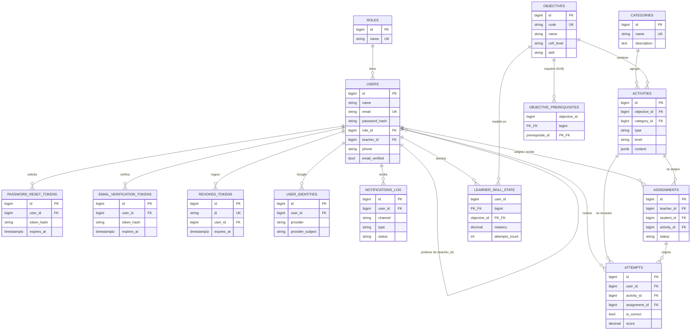

# English Lab

Aplicación web full stack para practicar gramática de inglés (niveles CEFR A1–B2). El **profesor** administra su banco de actividades, vincula estudiantes y les asigna tareas; el **estudiante** resuelve actividades (opción múltiple y completar espacios), recibe retroalimentación inmediata y ve su **dominio (mastery) por objetivo** con recomendaciones de qué practicar después; el **administrador** gestiona usuarios y categorías. Se puede entrar con correo y contraseña o con **Google**, y las cuentas nuevas verifican su correo.

## Enlaces
| | |
|---|---|
| Proyecto desplegado (HTTPS) | `https://english-labeq15.tech` |
| URL base de la API | `https://english-labeq15.tech/api/v1` |
| Prototipo de Figma | https://www.figma.com/proto/Tk9VgcMgRk0mCz2oysTGsM/Proyecto-Interfaz?node-id=7-2030&p=f&t=05j0tRsqkwrJlrEB-1&scaling=scale-down&content-scaling=fixed&page-id=0%3A1&starting-point-node-id=7%3A2030 |
| Tablero de GitHub Projects | `PEGAR_LINK_PROJECTS` |
| Repositorio | `PEGAR_LINK_REPO` |

## Equipo 15 

-  Perez Ramirez Samuel 
-  Nuñez Reyes Jorge Emilio 
-  Mendoza Vargas Braulio 

## Tecnologías
- **Backend:** Java 21, Spring Boot 3.5 (Web, Data JPA, Security, Validation, Mail), JWT (jjwt 0.12), BCrypt, Flyway, `spring-security-oauth2-jose` (validación del ID token de Google), Lombok.
- **Frontend:** React 18, Vite 5, React Router 6, Axios.
- **Base de datos:** PostgreSQL (migraciones con Flyway).
- **Pruebas:** JUnit 5, Mockito, Spring Boot Test y Testcontainers (backend). Bruno para probar la API.
- **Despliegue:** VPS con Nginx, systemd y Certbot; correo con Postfix local.

---

# Mapa de requisitos: dónde está cada cosa

Rutas relativas a la raíz del repositorio. Paquete Java base: `backend/src/main/java/com/englishlab/` (abreviado `…/`). Frontend: `frontend/src/` (abreviado `fe/`).

## 1. Base de datos
| Requisito | Dónde está |
|---|---|
| Migraciones versionadas (Flyway) | `backend/src/main/resources/db/migration/V1…V21` · `spring.flyway.enabled=true` y `spring.jpa.hibernate.ddl-auto=validate` (JPA **no** crea tablas) en `application.properties.example` |
| Mínimo 5 tablas relacionadas | **14 tablas** (ver diagrama ER): `V1` auth, `V2` contenido, `V3` aprendizaje, `V4` categorías, `V20` verificación de correo, `V21` identidades de Google |
| Al menos una relación N:M | `objective_prerequisites` (objetivo ↔ objetivo, `V2`); además `users` ↔ `activities` vía `assignments` y `attempts` (`V3`); `learner_skill_state` (usuario ↔ objetivo, PK compuesta) |
| Datos de prueba (10–15 por tabla principal) | `V10` (3 roles, 12 usuarios), `V11` (6 categorías, 12 objetivos, 9 prerrequisitos), `V12` (12 asignaciones, 13 intentos, 13 estados de dominio, 7 notificaciones), `V13–V17` y `V19` (≈1 400 actividades en total), `V18` (2 objetivos B2) |
| Diagrama ER en el README | Sección [Diagrama ER](#diagrama-er) |

## 2. Usuarios y roles
| Requisito | Dónde está |
|---|---|
| Tabla de roles relacionada con usuarios | `roles` y `users.role_id` en `V1__schema_auth.sql`; entidades `…/model/entity/Role.java`, `User.java` |
| 3 niveles de acceso | `ADMIN`, `TEACHER`, `STUDENT` (constraint `ck_roles_name`) |
| Un usuario sembrado por rol | `V10__seed_auth.sql`: 1 admin, 2 profesores, 9 estudiantes |
| Acceso por correo | Índice único case-insensitive `ux_users_email` (`V1`) |
| Contraseña: 8+ caracteres, mayúscula, número y carácter especial (backend) | `@Pattern` en `…/dto/AuthDtos.java` (registro y reset) |
| Misma regla en el frontend, bajo el input | `fe/lib/validators.js` (`PASSWORD_RE`, `PASSWORD_RULE`) usado en `fe/pages/Register.jsx`, `ResetPassword.jsx` y `fe/components/Input.jsx` |
| Restricción de endpoints por rol (Spring Security) | `…/security/SecurityConfig.java` (`SecurityFilterChain`: públicos explícitos, `anyRequest().authenticated()`, `@EnableMethodSecurity`) **y** `@PreAuthorize` en cada controlador |
| Rutas y componentes por rol en React | `fe/routes/ProtectedRoute.jsx` + `fe/App.jsx` (prop `allow={[...]}`), `homePathForRole` en `fe/auth/AuthContext.jsx` |
| Cliente/estudiante solo ve sus datos | `…/controller/StudentController.java` (`/me/...`, `@PreAuthorize("hasRole('STUDENT')")`) |

## 3. Backend (Spring Boot)
| Requisito | Dónde está |
|---|---|
| API REST con `@RestController` / `@RequestMapping` | `…/controller/`: `AuthController`, `StudentController`, `TeacherController`, `ContentController`, `AdminController`, `HealthController` (todo bajo `/api/v1`) |
| JWT (login, registro, logout, invalidación) | `…/security/JwtService.java` (claims `sub`, `role`, `jti`, `exp`), `JwtAuthenticationFilter.java`; logout guarda el `jti` en `revoked_tokens` (`…/service/AuthService.java`, `RevokedToken.java`) |
| Recuperación de contraseña | `POST /auth/forgot-password` y `/reset-password`; tabla `password_reset_tokens` (solo se guarda el hash del token); front: `ForgotPassword.jsx`, `ResetPassword.jsx` |
| Hash BCrypt | `BCryptPasswordEncoder` en `SecurityConfig.java`; hashes reales en `V10__seed_auth.sql` |
| Bean Validation en DTOs (sin validar a mano en controladores) | `@Valid @RequestBody` en los controladores; anotaciones en `…/dto/*Dtos.java` |
| Errores JSON con código correcto | `…/exception/GlobalExceptionHandler.java` (`@ControllerAdvice`, formato `ProblemDetail` con `fieldErrors`): **400, 401, 403, 404, 405, 422, 500, 503**. Los 401/403 de la cadena de seguridad usan el mismo formato (`SecurityConfig.writeProblem`) |
| Relaciones JPA y N+1 | Entidades en `…/model/entity/` con `FetchType.LAZY`; `@EntityGraph` en `UserRepository`, `AssignmentRepository`, `AttemptRepository`, `UserIdentityRepository`; `JOIN FETCH` en `ObjectiveRepository`; `spring.jpa.open-in-view=false` |
| DTOs, sin exponer entidades | `…/dto/` (`PageResponse`, `UserDtos`, `ActivityDtos`, `AttemptDtos`, …). Los DTO de estudiante **omiten la clave de respuesta** de las actividades |
| Paginación y filtros en el servidor | `…/util/PageableFactory.java` (page 0-based, `size` tope 100, `sort` con lista blanca); filtros como `@RequestParam` en `AdminController`, `ContentController`, `TeacherController` |
| Lógica de dominio | `…/domain/MasteryService.java` + `MasteryConfig.java` (dominio por objetivo), `…/service/RecommendationService.java`, `…/grading/GradingService.java` |

## 4. Frontend (React)
| Requisito | Dónde está |
|---|---|
| Axios con JWT en `Authorization` | `fe/api/client.js` (interceptor de request agrega `Bearer`; el de response limpia la sesión en 401 y redirige a `/login`) |
| Rutas protegidas por rol | `fe/routes/ProtectedRoute.jsx`, `fe/App.jsx` |
| Validaciones bajo cada input | `fe/components/Input.jsx` + `fe/lib/validators.js` |
| Sin `alert()` / `confirm()` nativos | Búsqueda en `fe/`: **0 usos**. Se usan `fe/components/ConfirmModal.jsx` y `fe/components/Toast.jsx` |
| Modales de confirmación | `ConfirmModal` en `InternalLayout.jsx` (cerrar sesión), `AdminUsers.jsx`, `AdminCategories.jsx`, `ActivityBank.jsx`, `StudentActivity.jsx` |
| Loading states y errores de red | `fe/api/useRemote.js` (estados `loading` / `real` / `error` con `reload`); `extractApiError` en `client.js`; timeout de 15 s |
| Paginación y filtros del lado del servidor | `fe/pages/admin/AdminUsers.jsx` (`page`, `size`, `role`, `text`), `fe/pages/shared/ActivityBank.jsx` (`level`, `skill`, `type`, `categoryId`, `text`), `fe/pages/shared/TeacherResults.jsx` |
| Diseño responsivo | `fe/styles.css` (`@media` en 970 / 850 / 700 px); en móvil la barra lateral colapsa a navegación horizontal (`fe/layouts/Shell.jsx`) |
| Navbar interna con datos del usuario | `fe/layouts/Shell.jsx` + `InternalLayout.jsx`: nombre, correo, avatar y botón **Salir** (logout real contra la API) |
| Inicio de sesión con Google | `fe/components/GoogleSignInButton.jsx` (solo aparece si existe `VITE_GOOGLE_CLIENT_ID`) |

## 5. Comunicación con el usuario
| Requisito | Dónde está |
|---|---|
| Correo con `JavaMailSender` → Postfix local | `…/service/NotificationService.java` (asíncrono con `@Async`, registra cada envío en `notifications_log` como `SENT` / `FAILED` / `PENDING`); `spring.mail.*` y `app.mail.*` en `application.properties.example` (host `127.0.0.1`, puerto 25, sin proveedor externo) |
| Correos que envía la aplicación | Bienvenida, **verificación de correo** (HTML + texto, `…/service/EmailVerificationTemplate.java`) y **recuperación de contraseña** |

## 6. Seguridad
| Requisito | Dónde está |
|---|---|
| Secretos fuera del repo | `.gitignore` excluye `application.properties`, `.env*`; los secretos vienen de variables de entorno (`JWT_SECRET`, `DB_USERNAME`, `DB_PASSWORD`, `GOOGLE_CLIENT_ID`, …) |
| `application.properties.example` | `backend/src/main/resources/application.properties.example` (sin valores reales) · `frontend/.env.example` |
| JWT sin secreto por defecto | `app.jwt.secret=${JWT_SECRET}` (≥ 32 bytes); expiración por defecto 60 min (`JWT_EXPIRATION_MS`) |
| CORS acotado | `…/config/AppConfig.java` (orígenes explícitos; sin `*` con credenciales) |
| Verificación de correo | `V20`, `…/service/EmailVerificationService.java`: token con hash SHA-256, TTL 24 h, *cooldown* de reenvío 60 s, máx. 5 envíos/hora, purga de cuentas sin verificar a los 7 días |
| Google OAuth seguro | `…/security/GoogleTokenVerifier.java` valida firma (JWKS), `aud` y correo verificado; se vincula por el `sub` inmutable, no por el correo (`V21__google_identities.sql`, `UserIdentity.java`) |

## 7. Pruebas
| Requisito | Dónde está |
|---|---|
| Pruebas automatizadas del backend | `backend/src/test/java/com/englishlab/`: `auth/GoogleAuthFlowIT`, `auth/EmailVerificationFlowIT` (integración con Testcontainers), `service/GoogleAuthServiceTest`, `service/EmailVerificationServiceTest`, `security/GoogleTokenVerifierTest` |

## 8. Diseño, GitHub y despliegue
| Requisito | Dónde está |
|---|---|
| Prototipo en Figma | Link en la sección Enlaces. Las pantallas del código están numeradas como el prototipo (`crumb="05 · Inicio estudiante"`, …`"16 · Categorías"` en `fe/App.jsx`) |
| Repo público, commits de ambos, README | Ver [Enlaces](#enlaces) |
| GitHub Projects público (Backlog / To Do / In Progress / In Review / Done) | Ver [Enlaces](#enlaces) |
| VPS: JAR con systemd, build estático, Nginx, HTTPS con Certbot | El backend corre como JAR bajo systemd, el frontend se sirve como build estático (`cd frontend && npm run build`) desde Nginx, que reenvía `/api/` al backend con HTTPS de Certbot |

---

## Diagrama ER

Relación **N:M**: `objectives` ↔ `objectives` mediante `objective_prerequisites` (grafo acíclico de prerrequisitos). Tablas: **14**.

## Instalación local
Requisitos: Java 21, Maven, PostgreSQL y Node 18 o superior.

1. **Base de datos** (vacía; Flyway crea tablas y datos al arrancar):
   ```sql
   CREATE DATABASE englishlab;
   ```
2. **Backend:**
   ```bash
   cd backend
   cp src/main/resources/application.properties.example src/main/resources/application.properties
   export DB_USERNAME=... DB_PASSWORD=...
   export JWT_SECRET=...            # 32+ caracteres
   export AUTH_LOG_RESET_TOKEN=true AUTH_LOG_VERIFICATION_LINK=true   # solo local: imprime los enlaces en consola
   mvn spring-boot:run              # http://localhost:8080
   ```
3. **Frontend** (otra terminal):
   ```bash
   cd frontend
   cp .env.example .env             # opcional: VITE_GOOGLE_CLIENT_ID
   npm install
   npm run dev                      # http://localhost:5173 (el proxy reenvía /api al backend)
   ```
4. **Pruebas del backend:** `cd backend && mvn test` (las de integración usan Testcontainers, requieren Docker).

## Credenciales de prueba
Los hashes BCrypt están en `V10__seed_auth.sql`; las contraseñas en claro **no están en el código**.

| Rol | Correo | Contraseña |
|---|---|---|
| ADMIN (evaluación) | `admin@englishlab.com` | `Admin123!` |
| TEACHER | `teacher1@englishlab.com` (estudiantes 1–5) · `teacher2@englishlab.com` (estudiantes 6–9) | `Password1!` |
| STUDENT | `student1@englishlab.com` … `student9@englishlab.com` | `Password1!` |

## Roles y seguridad
- **ADMIN**: gestión de usuarios (CRUD) y categorías (CRUD); además puede ver y administrar el banco de actividades.
- **TEACHER**: banco de actividades (CRUD), alta de estudiantes propios, asignación de tareas, seguimiento y resultados de sus estudiantes; lectura de categorías.
- **STUDENT**: solo sus datos: objetivos, práctica, intentos, tareas, resultados y progreso.
- JWT en `Authorization: Bearer <token>`; expira en 60 min por defecto. `POST /auth/logout` guarda el `jti` en `revoked_tokens`.
- Autorización con `SecurityFilterChain` **y** `@PreAuthorize`. Sesión STATELESS, sin CSRF (API con token).
- Errores JSON (`ProblemDetail`): 400, 401, 403, 404, 405, 422, 500 y 503 (por ejemplo, Google sin configurar).

## Endpoints principales (base `/api/v1`)
| Método y ruta | Rol |
|---|---|
| `GET /health` | público |
| `POST /auth/register · login · google · verify-email · resend-verification · forgot-password · reset-password` | público |
| `POST /auth/logout` | autenticado |
| `GET /me/objectives`, `/me/objectives/{id}/activities`, `/me/objectives/{id}/practice-session`, `/me/activities/{id}`, `/me/attempts/{id}`, `/me/assignments`, `/me/assignments/{id}/result`, `/recommendations/next`; `POST /attempts` | STUDENT |
| `POST/GET /teacher/students`, `GET /teacher/students/overview`, `/teacher/students/{id}/progress`, `GET/POST /teacher/assignments` | TEACHER |
| `GET/POST/PUT/DELETE /content/activities`, `GET /content/activities/{id}`, `GET /content/objectives` | ADMIN, TEACHER |
| `GET/POST/PUT/DELETE /admin/users` | ADMIN |
| `GET /admin/categories` (ADMIN, TEACHER) · `POST/PUT/DELETE /admin/categories` (ADMIN) | ver rol |

**Paginación y filtros en el servidor:** `?page=0&size=20&sort=campo,desc` (`size` máximo 100; el `sort` solo acepta campos de lista blanca). Filtros: usuarios `role, text`; actividades `level, skill, type, categoryId, text`; estudiantes `text`; asignaciones `status`. Respuesta paginada con `PageResponse`.

## Cómo funciona el dominio (mastery)
Cada intento actualiza el dominio del estudiante en `learner_skill_state` (valor inicial 0.30; se guarda también `previous_mastery`). Un objetivo solo se desbloquea cuando se dominan sus prerrequisitos (`objective_prerequisites`), y `RecommendationService` propone la siguiente actividad. Las claves de respuesta viven en el `jsonb content` de cada actividad y nunca se envían al navegador.

## Inicio de sesión con Google
1. El navegador obtiene un **ID token** de Google (Google Identity Services).
2. Lo envía a `POST /api/v1/auth/google`.
3. El backend lo valida (firma por JWKS, `aud` = nuestro Client ID, correo verificado) y devuelve el **mismo JWT** que el login normal, así que roles y rutas no cambian.

Configuración: `app.google.client-id` (`GOOGLE_CLIENT_ID`) en el servidor y `VITE_GOOGLE_CLIENT_ID` en el frontend (mismo valor). En Google Cloud Console agrega como *Orígenes de JavaScript autorizados* `http://localhost:5173` y el dominio del proyecto. Sin Client ID, el botón no aparece y el endpoint responde 503.

## Estructura del repositorio
```
backend/
  src/main/java/com/englishlab/   controller · service · repository · model/entity · dto · security · exception · domain · grading · config · util
  src/main/resources/db/migration Migraciones y seeds de Flyway (V1–V21)
  src/test/java/…                 Pruebas unitarias e integración
frontend/
  src/                            api · auth · components · layouts · lib · pages (student, teacher, admin, shared) · routes
```